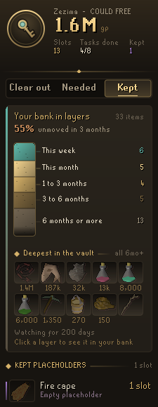

# Codex Bank Steward

**What in your bank is safe to sell or drop.**

Codex Bank Steward goes through your bank for two kinds of item. Some have done their work: every quest and achievement diary that needs them is finished. Others have sat untouched for months. The Steward shows what clearing them would bring in gold and bank slots, and marks them in the bank itself. It also lists what your unfinished quests still need, so you don't sell it by mistake.

Part of the **Codex** suite of RuneLite plugins. They share one look: warm ink, aged gold and the game's own fonts.

<p align="center">
  
  
  
</p>

## What it does

**Clear out.** The big figure is what the list could free, with the slots it frees. **Their work is done** lists items a finished quest or diary asked for, each with the quest it served. **Gathering dust** lists tradeable items that have not moved for 90 days (you can pick 14 days to two years). **Outclassed tools** lists a pickaxe or axe you own a faster one of and can use. Each item shows what it would sell for, or *Drop* when it can't be traded.

**Guided clear-out.** The plan says what the list brings by each route: **sell** on the Grand Exchange (after its 2% tax), **high alch** (after the nature rune) when that pays more, or **drop**. Ironman accounts alch or drop. Press **Begin the clear-out** and the page becomes a checklist, most valuable first. Each item is ticked off once it leaves your bank and pack, and a chat line says when you are done. **Show in bank** narrows the bank to just what is on the list, like a bank tag tab.

<p align="center">
  
  
</p>

**Needed.** Every unfinished quest and diary that holds something in your bank, with the items it holds and which other quest wants each one too. When any of several items will do (any pickaxe, say), only the best one you own is shown.

**Kept.** Click any item on the list to keep it off the list until you let it go. The Kept page opens on your bank drawn as rock layers by how long each item has sat untouched, from this week down to a year or more. Click a layer and the bank shows just its items.

**Tidy up.** Slots you can win back without selling anything: potions in several dose sizes that decanting would merge, and empty placeholders you no longer need.

**Bank marks and summary.** In the bank, done-with items carry a small gold diamond and dusty items a ring. The first time you open your bank each login, a chat line says what the list could free.

Nothing is ever sold, dropped or withdrawn for you. The Steward only advises.

## Settings that matter

- **Dust after** (90 days): how long an item sits untouched before it is called dusty.
- **Recent use grace** (14 days): a done-with item you used recently stays off the list.
- **Value items at** (Auto): Grand Exchange prices, or high alchemy; Auto uses high alchemy on ironman accounts.
- **Guard clue STASH gear** (on): gear a STASH unit wants is never called done with.
- **Show untradeable dust** (off): also list dusty untradeable items, apart and with a warning.
- **Mark items in the bank** and **Summary at the bank** (both on).
- **Keep kit and goal items** (on) and **Share bank with Codex** (on): see below.

## With other Codex plugins

The Steward works on its own. With other Codex plugins installed, it reads what they save and never changes it:

- **[Codex Quartermaster](https://github.com/Nubles/OSRS-Codex-Quartermaster):** nothing a saved kit, or a preset you picked, takes is ever listed. 240 sharks untouched for months stay put, marked *Kit: Vorkath*.
- **[Codex Navigator](https://github.com/Nubles/OSRS-Codex-Navigator):** quests on the way to a pinned goal lead the Needed page, and the page lists what those quests ask you to bring that you don't own yet, with what buying it costs.
- **[Codex Gear Roadmap](https://github.com/Nubles/OSRS-Codex-Gear-Roadmap):** with a savings goal set, the Clear out page shows how far your coins go toward it and how far selling the list takes you.

The Steward also saves your bank as last seen, so other Codex plugins know what is in it without opening it: Quartermaster, Plunder Pilot, Pest Control Pilot and others. **Share bank with Codex** turns this off and removes the saved copy.

## How it decides

An item is **done with** only when all of these hold:

- a quest, miniquest or diary asks for it, and every one that names it in any way is finished on this account;
- it is not a general good such as runes, coins, potions, teleports, food, ammunition or slayer gear, or anything named by more than five quests;
- no Quartermaster kit takes it and, unless you turn the guard off, no clue STASH unit takes it;
- it is not a lasting reward (diary rewards, capes, the ghostspeak amulet, the ectophial, void and the like);
- the stack is no bigger than leftovers from those quests, so 2,000 planks are not called spent because a diary once wanted 10;
- you have not used it within the grace days.

An item is **dusty** when it is tradeable, no kit takes it, and it has not moved for the dust time. An item has moved when its count in the bank changes, or whenever you carry or wear it. The Steward starts its clock the first time it sees your bank, so it only calls dust after it has watched that long. Everything is remembered per account in your RuneLite profile. A save damaged on disk keeps all it can: one unreadable entry or setting is lost alone.

## Where the quest data comes from

Which quests and diaries need which items comes from [Quest Helper](https://github.com/Zoinkwiz/quest-helper) (BSD 2-Clause), read by running its own helpers. It covers 263 quests, miniquests, diary tiers and Recipe for Disaster's parts, including items a quest only names in its steps. Clue STASH gear is read from RuneLite's own emote clue list. `tools/README.md` has the steps to rebuild `steward-data.json` when new quests release.

## For plugin authors: the shared bank

Group `codexbanksteward`, RS profile key `bankV1`:

```json
{"version":1,"savedAt":1760000000000,"items":{"385":240,"995":1234567,"26950":1},"truncated":false}
```

- `items`: every item in the bank by canonical item id (placeholders and noted forms folded into the item) with its quantity, in ascending id order. Potion storage and the inventory are not included.
- `savedAt`: when the bank was last seen, in epoch milliseconds. An unchanged bank is written again at most every five minutes, so it can be up to that old while you bank.
- `truncated`: true only if the bank held more than 2,000 kinds of item and the highest ids were left out.

The shape only grows; a breaking change would get a new key. It is written a moment after the bank settles, on logout, on a profile switch and when the client closes. `BankSnapshotTest` pins it. Readers should treat a missing or unreadable value as no snapshot.

## Rules posture

Codex Bank Steward only reads what the game already shows you: your bank, inventory and worn items, quest and diary progress, and RuneLite's own item prices, plus what the Codex plugins above save in your RuneLite profile. The only thing it writes beyond its own memory is the shared bank, in its own config group. Show in bank only filters what the bank window displays, through RuneLite's own Bank Tags plugin, as a tag tab would. It does not click, change menus, or send anything over the network.

## Development

```bash
./gradlew build   # compile and run tests
./gradlew run     # launch RuneLite with the plugin loaded
```

The Steward's judgement (`core/`) is plain Java with unit tests. The panel and bank marks are in `ui/` and `overlay/`.
