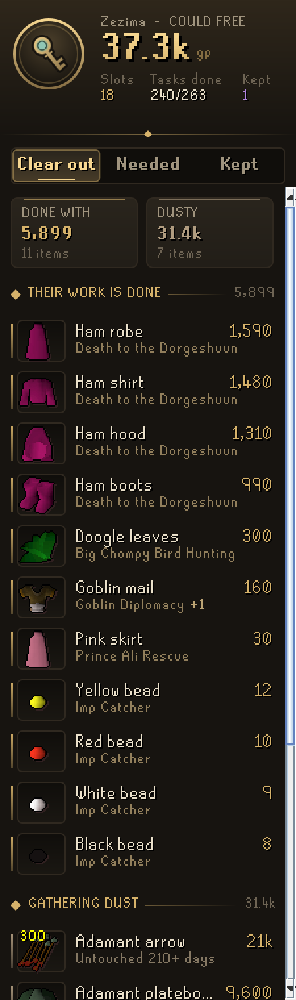
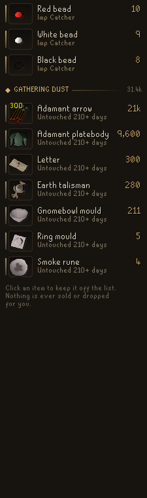
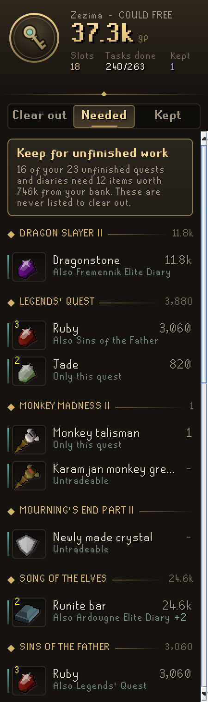
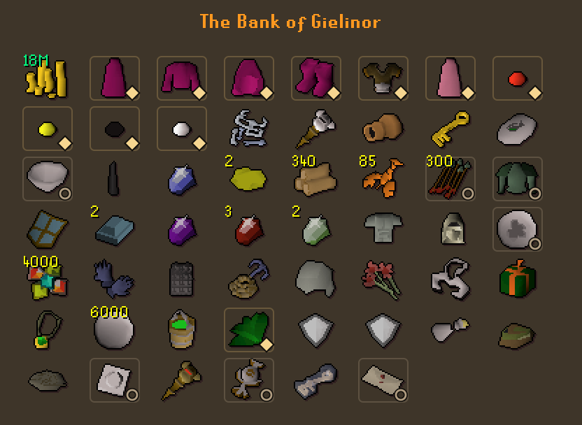

# Codex Bank Steward

**What in your bank is safe to sell or drop.** Codex Bank Steward goes through your bank and finds the items whose work is done, because every quest and achievement diary that needs them is finished, and the items that have sat untouched for months. It shows what clearing them would bring in gold and in bank slots, marks them in the bank itself, and lists what your unfinished quests and diaries still need so you don't sell it by mistake.

It is the seventh plugin in the **Codex** suite, after [Codex Navigator](https://github.com/Nubles/OSRS-Codex-Navigator), [Codex Guardian](https://github.com/Nubles/OSRS-Codex-Guardian), [Codex Log Insight](https://github.com/Nubles/OSRS-Codex-Log-Insight), [Codex Gear Roadmap](https://github.com/Nubles/OSRS-Codex-Gear-Roadmap), [Codex Session Chronicle](https://github.com/Nubles/OSRS-Codex-Session-Chronicle) and [Codex Ledger](https://github.com/Nubles/OSRS-Codex-Ledger), and shares their look: warm ink, aged gold and the game's own fonts.

<p align="center">
  
  
  
</p>

## What it does

- **Clear out.** What the list could free in large gilt figures, with the slots it frees. Under it, **Their work is done**: items a finished quest or diary asked for, each with the quest it served (Ham robe, *Death to the Dorgeshuun done*), and **Gathering dust**: items that have not moved for 90 days (you can pick anywhere from 14 days to two years). Each shows what it would sell for, or *Drop* when it can't be traded. Only tradeable items are ever called dusty.
- **Needed.** Every unfinished quest and diary that is holding something in your bank, with the items it holds and which other quest wants each one too. When a need can be met by any of several items (any pickaxe, say), only the best one you own is shown.
- **Kept.** Click any item on the list to keep it. Kept items stay off the list until you let them go.
- **Bank marks.** In the bank, items whose work is done carry a small gold diamond and dusty items a ring of ash, so you can clear the list without looking back at the panel.
- **Ironman friendly.** Values are Grand Exchange prices, or high alchemy on ironman accounts (the *Value items at* option chooses).
- **Bank summary.** The first time you open your bank each login, a line in the chat box says how many items could go and what they would free. It can be turned off.

<p align="center">
  
</p>

## How it decides

An item is **done with** only when all of these hold:

- a quest, miniquest or diary in the Steward's list asks for it, and every one that names it in any way (asks for it, recommends it, or has you pick it up along the way) is finished on this account;
- it is not a general good: runes, coins, tools and moulds, potions, teleports, pouches, ores, bars, logs, planks, gems, herbs, seeds, hides, food ingredients, ammunition, slayer gear, or anything named by more than five quests or only as one choice among many;
- it is not a lasting reward or access item (diary rewards, capes, ghostspeak amulet, ectophial, greegrees, salve amulet, void, the karambwan vessel, the battered key to the Elemental Workshop, the dark totem, Darklight and the like);
- the stack is no bigger than leftovers from those quests, so 2,000 planks you gathered for Construction are not called spent because a diary once wanted 10;
- you have not used it in the last 14 days (configurable).

An item is **dusty** when it is tradeable and has not moved for the dust threshold. Untradeable items are never called dusty, since one the Steward cannot explain may be a reward you can't get back. The Steward starts its clock the first time it sees your bank, so dust is only called after it has watched that long; until then the page shows how many days it has watched. An item has moved when its count in the bank changes or whenever you carry or wear it. The bank is remembered as last seen, per account, in your RuneLite profile.

Nothing is ever sold, dropped or withdrawn for you. The Steward only advises.

## Where the quest data comes from

The list of which quests and diaries need which items comes from [Quest Helper](https://github.com/Zoinkwiz/quest-helper) (BSD 2-Clause), read by running its own helpers, so it covers 263 quests, miniquests, diary tiers and Recipe for Disaster's parts, including the items each quest only names in its steps. Each part of Recipe for Disaster is read on its own, so a finished part frees its items. `tools/README.md` has the steps to rebuild `steward-data.json` when new quests release.

## Rules posture

Codex Bank Steward only reads what the game already shows you: your bank, inventory and worn items, quest and diary progress, and RuneLite's own item prices. It does not click, change menus, or send anything over the network.

## Development

```bash
./gradlew build   # compile and run tests
./gradlew run     # launch RuneLite with the plugin loaded
```

The Steward's judgement (`core/`) is plain Java with unit tests; the panel and bank marks are in `ui/` and `overlay/`.
