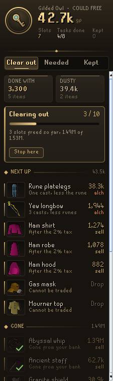

# Codex Bank Steward

**What in your bank is safe to sell or drop.** Codex Bank Steward goes through your bank and finds the items whose work is done, because every quest and achievement diary that needs them is finished, and the items that have sat untouched for months. It shows what clearing them would bring in gold and in bank slots, marks them in the bank itself, and lists what your unfinished quests and diaries still need so you don't sell it by mistake.

It is the seventh plugin in the **Codex** suite, after [Codex Navigator](https://github.com/Nubles/OSRS-Codex-Navigator), [Codex Guardian](https://github.com/Nubles/OSRS-Codex-Guardian), [Codex Log Insight](https://github.com/Nubles/OSRS-Codex-Log-Insight), [Codex Gear Roadmap](https://github.com/Nubles/OSRS-Codex-Gear-Roadmap), [Codex Session Chronicle](https://github.com/Nubles/OSRS-Codex-Session-Chronicle) and [Codex Ledger](https://github.com/Nubles/OSRS-Codex-Ledger), and shares their look: warm ink, aged gold and the game's own fonts.

<p align="center">
  
  
  
</p>

## What it does

- **Clear out.** What the list could free in large gilt figures, with the slots it frees. Under it, **Their work is done**: items a finished quest or diary asked for, each with the quest it served (Ham robe, *Death to the Dorgeshuun done*), and **Gathering dust**: items that have not moved for 90 days (you can pick anywhere from 14 days to two years). Each shows what it would sell for, or *Drop* when it can't be traded. Only tradeable items are ever called dusty.
- **Needed.** Every unfinished quest and diary that is holding something in your bank, with the items it holds and which other quest wants each one too. When a need can be met by any of several items (any pickaxe, say), only the best one you own is shown.
- **Guided clear-out.** A plan at the top of the page says what the list brings by each route: **sell** on the Grand Exchange (after its 2% tax), **high alch** (after the nature rune) when that pays more, or **drop** when neither brings anything. Ironman accounts alch or drop. Press *Begin the clear-out* and the page becomes a checklist, most valuable first; each item is ticked off once it leaves your bank and pack, with a bar for the slots and gold freed so far and a chat line when it is done.
- **Kept for your kits and goals.** If you use [Codex Quartermaster](https://github.com/Nubles/OSRS-Codex-Quartermaster), nothing a saved kit, or a preset you picked, takes is ever called done with or dusty: 240 sharks untouched for months stay put, marked *Kit: Vorkath*. If you use [Codex Navigator](https://github.com/Nubles/OSRS-Codex-Navigator), quests on the way to a pinned goal lead the Needed page with a pennant (*On the way to Dragon Slayer II*), and what those quests only mention, such as a recommended teleport, is never called dusty. The Steward only reads what those plugins save; it works the same without them.
- **Outclassed tools.** A pickaxe, axe or felling axe you own a faster one of, and have the Mining or Woodcutting level to use, joins the clear-out: *Rune pickaxe, Dragon pickaxe is faster*. Gilded, 3rd age and other trophy tools are never listed, nor a tool you are carrying, a kit takes, a STASH unit wants or an unfinished quest asks for.
- **To get for your goals.** With [Codex Navigator](https://github.com/Nubles/OSRS-Codex-Navigator) goals pinned, the Needed page lists what each goal's unfinished quests and diaries ask you to bring that you do not own yet, what you have of it, and what buying it costs: *To get: Dragon Slayer II, Rope, have 1 of 3*. Ironmen see what to gather instead. Untradeable quest items, which the quests hand you, are left out.
- **Toward your savings goal.** If [Codex Gear Roadmap](https://github.com/Nubles/OSRS-Codex-Gear-Roadmap) has a savings goal, the Clear out page shows how far your coins go toward it and how far selling the list takes you: *Toxic blowpipe, your coins cover 61%. Selling this list covers the rest.* Pieces you already own are not counted, and ironmen do not see it.
- **Tidy up.** Slots you can win back without selling anything. Potions kept in several dose sizes show how many slots decanting them into 4-dose potions frees (*Prayer potion, 103 doses in 4 slots, 2 slots*); potions already on the clear-out list are left out. Empty placeholders are listed once the quests that wanted their item are done, or once they have stood empty past the dust time, and are marked in the bank with a dashed rim and a small cross. A placeholder a kit, a goal or an unfinished quest still wants, a lasting reward's, or one for an item you carry is never listed. Click one to keep it; kept placeholders are on the Kept page.
- **Clue STASH gear.** Gear that fills a clue STASH unit (steel platebody, brown apron and the rest, for every tier) is never called done with because a quest is finished. It can still be dusty, and then says it is STASH gear.
- **Untradeable dust, if you want it.** An option lists untradeable items untouched past the dust time, apart and under a warning, never in the totals. It is off by default.
- **Kept.** Click any item on the list to keep it. Kept items stay off the list until you let them go.
- **Your bank in layers.** The Kept page opens on your bank drawn as rock strata by how long each item has sat untouched: this week, this month, 1 to 3 months and down to a year or more, as far back as the Steward has watched. Once three months are watched the headline says how much of the bank has not moved in that time. Under it, the ten items lying deepest, greyed with their dust; when they have all lain still as long, the most valuable stacks are shown, each with what it is worth. **Click a layer** and the bank shows just its items (`tag:steward-layer` in the bank search does the same), so you can go through what has sat there longest; items you take out leave the view.
- **Bank marks.** In the bank, items whose work is done carry a small gold diamond and dusty items a ring of ash, so you can clear the list without looking back at the panel.
- **Show in bank.** With the bank open, *Show in bank* on the clear-out plan narrows the bank to just the items on the list, the way a bank tag tab does, so you can withdraw them in one sweep; during a clear-out it shows only what is still to go. The Tidy up section has its own, for the potions to decant and the placeholders to release. Typing `tag:steward` or `tag:steward-tidy` in the bank search does the same. It uses RuneLite's Bank Tags plugin, never changes your own tags, and the view closes with the bank.
- **Ironman friendly.** Values are Grand Exchange prices, or high alchemy on ironman accounts (the *Value items at* option chooses).
- **Bank summary.** The first time you open your bank each login, a line in the chat box says how many items could go and what they would free. It can be turned off.

<p align="center">
  
</p>

## How it decides

An item is **done with** only when all of these hold:

- a quest, miniquest or diary in the Steward's list asks for it, and every one that names it in any way (asks for it, recommends it, or has you pick it up along the way) is finished on this account;
- it is not a general good: runes, coins, tools and moulds, potions, teleports, pouches, ores, bars, logs, planks, gems, herbs, seeds, hides, food ingredients, ammunition, slayer gear, or anything named by more than five quests or only as one choice among many;
- no Codex Quartermaster kit takes it and, unless you turn the guard off, no clue STASH unit takes it;
- it is not a lasting reward or access item (diary rewards, capes, ghostspeak amulet, ectophial, greegrees, salve amulet, void, the karambwan vessel, the battered key to the Elemental Workshop, the dark totem, Darklight and the like);
- the stack is no bigger than leftovers from those quests, so 2,000 planks you gathered for Construction are not called spent because a diary once wanted 10;
- you have not used it in the last 14 days (configurable).

An item is **dusty** when it is tradeable, no Codex Quartermaster kit takes it, and it has not moved for the dust threshold. Untradeable items are never called dusty, since one the Steward cannot explain may be a reward you can't get back. The Steward starts its clock the first time it sees your bank, so dust is only called after it has watched that long; until then the page shows how many days it has watched. An item has moved when its count in the bank changes or whenever you carry or wear it. The bank is remembered as last seen, per account, in your RuneLite profile.

Nothing is ever sold, dropped or withdrawn for you. The Steward only advises.

## Where the quest data comes from

Clue STASH gear is read from RuneLite's own emote clue list, and the quests each Navigator goal needs first from Codex Navigator's quest data. The list of which quests and diaries need which items comes from [Quest Helper](https://github.com/Zoinkwiz/quest-helper) (BSD 2-Clause), read by running its own helpers, so it covers 263 quests, miniquests, diary tiers and Recipe for Disaster's parts, including the items each quest only names in its steps. Quests Quest Helper has no helper for yet (Learning the Ropes, The Frozen Door, Into the Tombs) are listed with no items, so a Navigator goal naming them still counts them. Each part of Recipe for Disaster is read on its own, so a finished part frees its items. `tools/README.md` has the steps to rebuild `steward-data.json` when new quests release.

## The shared bank (for other plugins)

Each time you use your bank, the Steward saves the whole bank as last seen in your RuneLite profile, so other Codex plugins know what is in it without opening it themselves: Plunder Pilot finds a freshly found Pharaoh's sceptre, Pest Control Pilot counts your void seals, Quartermaster counts your supplies before it has seen the bank. The *Share bank with Codex* option turns this off and removes the saved copy.

It is a documented contract. Group `codexbanksteward`, RS profile key `bankV1`:

```json
{"version":1,"savedAt":1760000000000,"items":{"385":240,"995":1234567,"26950":1},"truncated":false}
```

- `items`: every item in the bank by canonical item id (placeholders and noted forms folded into the item) with its quantity, in ascending id order. Potion storage and the inventory are not included.
- `savedAt`: when the bank was last seen, in epoch milliseconds. An unchanged bank is written again at most every five minutes, so it can be up to that old while you bank.
- `truncated`: true only if the bank held more than 2,000 kinds of item and the highest ids were left out.

The shape only grows; a breaking change would get a new key. It is written a moment after the bank settles, on logout, on a profile switch and when the client closes. `BankSnapshotTest` pins it, and each reader's tests hold a copy of the same JSON. Readers should treat a missing or unreadable value as no snapshot and fall back to what they had before.

## Rules posture

Codex Bank Steward only reads what the game already shows you: your bank, inventory and worn items, quest and diary progress, and RuneLite's own item prices, plus the kits, goals and savings goal Codex Quartermaster, Codex Navigator and Codex Gear Roadmap save in your RuneLite profile, which it never changes. The only thing it writes beyond its own memory is the shared bank above, in its own config group. Show in bank only filters what the bank window displays, through RuneLite's own Bank Tags plugin, as a tag tab would. It does not click, change menus, or send anything over the network.

## Development

```bash
./gradlew build   # compile and run tests
./gradlew run     # launch RuneLite with the plugin loaded
```

The Steward's judgement (`core/`) is plain Java with unit tests; the panel and bank marks are in `ui/` and `overlay/`.
